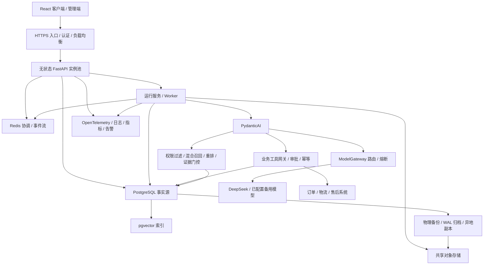

# 生产化总体架构

状态：目标架构与已实施能力并存，尚未生产验收。初始基线日期2026-10-01；当前摘要更新2026-10-26。本文不表示当前版本可直接上线，分批证据及限制见[实施与验收记录](production-verification.md)。

## 当前能力和改造边界

应用仍采用React、FastAPI、PydanticAI单Agent与独立ModelGateway。默认模型DeepSeek，保留OpenAI和逐主机回环兼容接口；跨在线供应商外发默认禁止，须租户管理员显式同意。已实施PostgreSQL/Alembic数据路径、身份与运行角色边界、耐久队列/租约/SSE、Redis准入、对象存储与加密逻辑备份、费用预算/共享熔断、pgvector混合检索及灰度控制。SQLite/本机文件仍有兼容路径，不能据此推断正式部署已切换。

当前schema head为0037。索引双人审批、候选run快照、阶段观察/推进、异常原子暂停、owner控制CLI及新UUID回退路径已有隔离合成测试；并非正式审批UI、可信业务质量或自动紧急回切验收。真实在线模型、供应商账单、双Linux主机/数据库Redis HA、正式业务系统接口和独立业务批准盲测仍缺。订单、物流、退款资格现有模拟工具不能算权威业务联调，联系登记也不能替代外部CRM工单。后文组件表描述目标职责，各项完成程度以当前证据而非设计文字判断。

本轮文档范围包括数据库、备份、观测、工具安全、运行协调、模型路由、RAG、部署与灾备。客户认证、RBAC、租户隔离和真实业务 API 是相关实施的前置条件，必须纳入实施清单；不凭本机来源检查推断生产权限。

保留 PydanticAI 单 Agent 和 ModelGateway 边界。仅在评测证明需要时增加多 Agent。架构复杂度随容量与业务要求逐步增加。

## 推荐组件及职责

| 组件 | 原理与作用 | 初期选择 |
| --- | --- | --- |
| 业务数据库 | 事务、唯一约束、行锁保存不可丢失事实 | PostgreSQL，SQLAlchemy 2，Psycopg 3，Alembic |
| 协调层 | 分布式限流、通知、短期事件和缓存 | Redis；持久化任务事实留在 PostgreSQL |
| Agent | 参数校验、工具循环、延期审批 | PydanticAI |
| 模型网关 | 按能力、数据政策、预算和健康状态选模型 | DeepSeek 优先；管理员配置的 OpenAI/本地模型备用 |
| 检索 | 关键词与向量召回、融合、重排、证据门控 | PostgreSQL 关键词索引 + pgvector + 本地 Reranker |
| 文件 | 共享原文、图片与备份，摆脱实例本地磁盘 | S3 兼容对象存储，私有桶与版本控制 |
| 观测 | 跨 HTTP、模型、工具、数据库追踪请求 | OpenTelemetry、Prometheus、Grafana、Loki、Tempo |
| 部署 | 不可变制品、健康摘流、版本回切 | Linux 容器；先托管容器/双实例，必要时 Kubernetes |

这些是技术方向；依赖版本、云平台、容量与费用在实施 ADR 中冻结。pgvector 属于向量存储方案，不要求另起一套向量数据库。PostgreSQL 标准全文检索不是 BM25，中文分词和关键词排序方案需单独评测，见 [RAG 方案](rag-upgrade.md)。

## 目标依赖关系

## 数据与权限边界

- PostgreSQL 是会话、工具操作、审批、任务和费用的事实源；Redis 丢失不能丢失订单操作结果。
- 原文和图片使用租户内对象键、哈希与版本；数据库保存元数据与引用。公开 URL 不暴露桶内容，签名 URL 或认证资产接口校验访问权限。
- 认证上下文由服务端传入 AgentDeps/ToolContext，模型不能指定用户、租户或权限。检索和业务工具都验证资源归属。
- 密钥仅由用户在管理界面提供。采用 KMS/Secret Manager 包装密钥与轮换，不自动使用环境中历史模型密钥；备份不输出明文密钥。
- 向外部模型发送内容前检查租户数据政策。跨在线供应商故障切换默认禁止；租户管理员必须逐目标供应商显式授权发送本轮用户消息和公司知识片段，授权版本、操作者、时间与撤销写入耐久审计。Worker 每次实际外发前重新校验，不能仅信任入队时的快照；无授权、撤权或状态不明时只能使用合格本机模型或安全失败。
- 当前仅有 OpenAI 的租户授权管理入口和 PostgreSQL 状态/审计；无自动跨供应商路由。授权开启不会触发外发，候选筛选和 Worker 外发前复核仍是 S5 门槛。
- 管理入口与客户入口使用不同权限策略，可信代理配置和 TLS 配置通过后才替换本机限制。

## 多实例执行与恢复

目标为 API 接收命令、Worker 执行 Run、共享事件层提供 SSE。PostgreSQL 事务创建 Run、任务和 Outbox，Worker 通过租约领取；每次领取递增 fencing token，只有当前持有者可提交结果。数据库建立会话活动运行唯一性约束，抢占在事务中先标记旧 Run cancelling，再调度新 Run。

取消先写数据库意图，再经 Redis 通知执行者；Worker 在心跳与工具边界复查数据库，因此通知丢失不会永久漏取消。Redis Pub/Sub 只作加速，不承担恢复保证。SSE 使用有序 event_id 和可重放事件；Redis Streams 保留短期事件，最终消息与终态在 PostgreSQL，过期游标返回快照。未来事件和重连接口必须同步更新前端与契约测试。

进程故障不保证从 token 中间继续生成。只读 Run 可按政策新建 attempt、清除旧草稿并重试；写操作先核对工具操作状态，不重放未知结果。审批通过完整 PydanticAI 消息和 DeferredToolResults 恢复逻辑流程。当前 recover_interrupted_runs() 的全局扫表不能在每个生产实例启动时运行，须换成租约过期回收。

当前已实现的范围更窄：排队聊天 Run 仅在首次失租且模型请求前的耐久账本、工具和事件均证明尚无外部执行，并且未取消/过期时，原 Run 通过新 fence 最多重新领取一次；任何已开始的模型尝试都可能已收费，不自动重放。知识解析目前失租终结并保留已发布结果，不自动重试。这不等于上段目标中的通用只读 attempt 重试或写工具对账。

Redis 是协调系统，不是耐久执行平台。跨小时审批或复杂补偿先以数据库等待状态实现；出现多个跨系统长流程后评估 Temporal，避免同时维护多套工作流事实源。

## ModelGateway 路由与降级

路由输入包含场景、所需工具/结构输出能力、上下文长度、数据政策、预算、供应商健康和剩余期限。每次模型请求记录独立 attempt，Run 保存所有尝试和最终模型，不能仅保存一个 provider 字段。

| 情况 | 策略 |
| --- | --- |
| 连接失败、429、5xx | 同模型有限退避，遵守 Retry-After；在总时限和费用预算内切换合格备用 |
| 401/403、余额或配置错误 | 禁用受影响配置并告警；仅在政策允许且备用已配置时切换 |
| 输入过长、业务参数错、权限拒绝 | 修正输入或返回明确结果，不作为供应商故障重试 |
| 输出格式错误 | 有界校验重试；持续失败后能力降级并记录原因 |
| 已发送 SSE 草稿 | 使用显式 answer_reset 和新 attempt 标识；客户端不拼接两个模型的回答 |
| 写操作结果未知 | 先查询外部流水或幂等结果，不重启整个 Agent 规划 |

熔断按供应商/模型/凭证配置维度管理，shared 状态支持 closed/open/half-open，限制探测数量。退避加随机抖动，SDK 和网关重试预算统一，避免层层重试放大请求。取消、权限和输入错误不计入供应商故障率。候选顺序：DeepSeek → 已配置且租户逐供应商授权的合规在线备用 → 已验收本机模型 → 仅证据展示/人工入口；未授权在线备用绝不成为候选，本地模型能力不足时禁用写工具。

本地模型目标接口已确定为**每台应用主机各自的回环 OpenAI 兼容端点**，不是跨主机共享一个回环地址。路由配置保存逻辑供应商、模型、能力与数据政策；各节点用受控部署配置解析本机固定端点，禁止管理员输入任意 URL、代理环境变量改写出口、重定向到非回环地址或 DNS 名称绕过边界。API/Worker 仅连接本机服务，端点不得由反向代理或防火墙开放给外部；两台主机须分别部署、配置和验收同一能力档位。节点本地模型失效时，只有满足租户数据政策、授权、能力、预算与总时限的其他已配置模型才可接管；否则安全失败。管理页未来提供配置与健康状态，但不能把单节点健康误显示为集群健康。当前已有回环端点校验、网关和管理配置入口，尚无真实本地推理/双节点验收及自动路由。

## 生产目标与证据

建议初始 SLO：月度可用性 99.5%，成功只读问答 P95 首 token ≤ 5 秒、总时长 ≤ 30 秒。排队拒绝与供应商失败计入失败，用户主动取消单独统计；导入和审批等待不纳入实时问答时延。数值待真实模型和容量测试后冻结。

建议业务数据库 RPO ≤ 5 分钟、RTO ≤ 60 分钟；服务实例故障摘流 ≤ 60 秒。文件、索引、密钥恢复另计并纳入整体演练。复制故障切换可能丢失未复制事务，其 RPO 不能用备份目标代替。实时问答允许中断后重试；外部业务操作必须能对账。

完整路线见 [实施清单](production-roadmap.md)，数据见 [迁移与备份](postgresql-migration.md)，运行证据见 [可观测性](observability.md)，工具见 [安全规范](business-tool-security.md)，发布恢复见 [Runbook](deployment-dr-runbook.md)。
