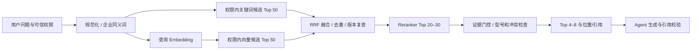

# 知识库混合检索与重排升级方案

最新head为0037，默认PostgreSQL向量Worker及[浏览器/SSE](rag-browser-acceptance.md)已验，已有[操作观察窗口](rag-observation.md)与[受控推进/最终提升内部事务](rag-rollout-advance.md)；仍缺自动调度/异常动作、真实控制入口、新制品及生产验收。下方早期批次与历史测试保留原范围。

0031 当前状态：已新增独立审批意向存储、冻结定义/严格版本递增、最小权限与恢复后重审，以及 owner 内部审批与一次性原子发布服务。不能把表中 approved 当授权，执行时必须复查当前身份/证据；尚无 HTTP/UI 入口或灰度/回切控制器。详见[当前服务边界](rag-release-approvals.md)。下方无迁移/0030/旧镜像等表述均为各自历史批次，不替代当前 schema 事实。

灰度接入约束：当前 `KnowledgeService.active_index_id/require_index`、`RepositoryVectorRetriever`、仓库向量 SQL 和回答提交均绑定全租户 active 索引。后续必须统一引入受信灰度路由与不可变 run 绑定（tenant/session/release/index/路由版本），SQL 内验证候选授权，提交事务复查发布状态；不得只把 SQL 的 active 放宽成 ready，也不得通过外部请求任意指定候选索引。暂停/回切必须拒绝撤回路由下的在途答案并保留审计。现行服务的一次性 active 切换不计作灰度完成。

质量门槛比较器（2026-10-25，**未接入发布授权**）：`app.rag_release_gate.assess_quality` 要求完整显式策略和单次生成事实审阅证据，绑定目标 tenant/index UUID、manifest、题集、来源映射、模型配置及 Prompt SHA-256；无默认放行参数。证据必须分开记录可回答/不可回答样本、支持答案/正确拒答数、泄漏案例、P95、费用/币种、UTC 完成时间及至少两名不同审阅者的引用。检索-only 评分格式不能代入，不能用 `approved=true` 替代契约。样本不足、上下文不符、过期/未来报告、越界指标和任何泄漏都会失败关闭；费率比较使用精确整数比例，拒绝 NaN/Infinity、布尔计数和异常精度。

输出仅是 `thresholds_satisfied`、固定原因码与策略/证据/绑定哈希，并明确 `threshold_assessment_not_release_authorization`；不读问题/文档/密钥、不调用模型、不切索引。两条不同审阅 UUID 与正确 scope 字符串**不能证明真人独立审阅或业务批准**，自报计数/费用也不是事实或账单核验。接入前仍需受信评测运行器、冻结报告、身份/签名/批准状态验证和耐久审批控制面；不得把可由普通业务角色写入的审计日志作为可信审批状态。现有 owner CLI 仍只执行既有 CAS/manifest/审计保护，尚未强制消费该比较器结果，不能称作完整质量发布门禁。

最新制品补验（2026-10-25）：发布审计/CAS 已进入完整镜像 3d0880...，在合成空文档租户验证审计失败回滚与独立 CLI 激活/回切成功，不挂载 app 代码；同一镜像漏洞扫描/SBOM 通过。该补验只证明控制链和制品装配，不补充业务质量或灰度门槛，详见[验收记录](production-verification.md)。

2026-10-25 发布控制增量：`RagIndexAdmin` 的 stage、stage-existing、seal、activate 和非空旧向量 prune 现与审计同事务；审计失败不保留变更/删除。运维数据库 owner 不是租户用户，沿用现有全局运维审计范围（legacy/control tenant，actor_id=NULL、actor=current_user），元数据明确记录 target_tenant_id，不伪造成员身份；普通租户管理页不会自动获得该控制域审计。

库级 `activate` 与 CLI 同样要求显式旧 active 预期值：首次激活传 `expected_active_index_id=None`，后续传实际旧 UUID；省略即拒绝。持发布排他锁后复查预期值及 manifest，切换和审计同事务，两个相同旧值的并发发布仅一个成功。回切仍需 stage-existing/seal/activate 的新索引身份和当前旧 active 预期值。审计只存目标租户/索引/profile UUID、旧 active UUID、manifest/计数等控制信息，不存问题、原文或向量。

本批真实 PostgreSQL 发布/审计/竞争及既有检索、回答提交锁等回归通过；具体数字见[验收记录](production-verification.md)。没有新增数据库迁移，head 仍为 0030。尚未实现批次审批、业务质量门槛、自动停止/回切和真实灰度流量验收，不将这些基础控制等同完整 S6。下方“审计待实现”属于本批之前状态。

2026-10-24 候选回补：检索保留最多 100 条的有界备用池，在最终租户/可见性/文档版本校验后再截取 Top-K。首条在检索后更新或撤销时，可以由后续仍有效的候选补位；候选来源的 SQL 权限过滤和回答提交前的证据复核继续生效。真实隔离 PostgreSQL 已验证首条版本变化后的补位。

2026-10-23 旧向量清理增量：迁移 owner 可按**指定租户**、每次最多 1000 条删除已删除、非 ready 或文档版本已被取代的 Embedding。清理前持久恢复保护和 owner 校验仍生效；当前 ready 文档版本的向量、其他租户、切块快照以及退役 profile 下仍可能用于回切的**当前版本**向量保留。入口 `scripts/prune_rag_embeddings.py` 需要私有 owner 数据库 URL 文件、租户 UUID 和 `--confirm-stale-prune`，一次只处理一批；运行前核对备份 freshness，重复执行至返回 0。它不清理旧快照或无引用 profile，也不替代索引 shadow／灰度、容量/成本或质量盲测。隔离真实 PostgreSQL 已验证当前版本保留、旧版本逐批清理、跨租户隔离和无确认拒绝。

操作示例：`python scripts/prune_rag_embeddings.py --database-url-file <私有 owner URL 文件> --tenant-id <租户 UUID> --batch-size 1000 --confirm-stale-prune`。仅在离线维护窗口、完成可恢复备份核验后执行；每次只删一批，输出仅为条数，不含文档内容。不能把清理条数作为索引质量或查询容量验收。

2026-10-22 同句锚点约束：数字／型号安全检查由“答案所有锚点在本轮任意资料中出现”收紧为“答案同一句的锚点必须共同出现在同一检索片段的同一句”。合成反例 `QX-900 保修 2 年` 与 `QX-800 保修 7 年` 不能被拼成 `QX-900 保修 7 年`，即使两句话来自同一个切块；真实 PydanticAI 工具循环也验证清除引用后拒答。仍无法证明同句的主谓关系、否定和隐含事实；跨句综合、混合工具数字可能被保守拒答，需在独立评测中衡量误拒。

2026-10-22 数字／型号事实锚点增量：对已调用知识检索且有候选的回答，服务端从本轮提供给模型的片段及标题提取规范化数字、日期和含数字的型号标识；若回答出现证据中不存在的锚点，则清除引用并给出确定性“无法确认”，不向 SSE 发送该草稿。合成用例覆盖 `QX-900`、保修 `99 年` 的编造以及有据 `7 年` 的保留。它是**必要条件而非充分事实支持**：即使每个数字都出现在资料中，数字与主语的关系、否定、冲突和无数字断言仍可能错误；知识检索与其他工具混用时，其他工具给出的数字也可能触发保守拒答。不能把该规则单独作为生产证据门控。后续仍需逐事实来源归属、独立语义支持判定与真实脱敏盲测。

2026-10-23 锚点门控收紧：逗号现在也作为证据子句边界；回答显式使用 `[资料 n]` 时，数字/型号锚点必须出现在所指来源的同一子句，越界的资料编号直接拒答。修复“同一句逗号两侧型号/保修数字串配”及“正确数字却标错来源”的合成用例。仍不能识别同一子句内的错配、否定或无数字断言，不构成语义事实支持判定。

2026-10-22 空证据拒答与 SSE 暂存增量：Agent 调用知识检索后若没有可引用结果，最终输出由本地校验器确定为安全的“无法确认”，不能由模型生成的公司事实覆盖。知识检索后的模型文本先在服务端暂存，只有最终输出校验、引用来源当前性复核及回答持久化成功后才向 SSE 页面发送；资料撤销或提交失败时不把旧资料回答短暂显示给用户。真实 PydanticAI 合成工具循环、SSE 和撤销专项已覆盖。该门控只处理**零候选和传播时序**，不能证明有候选时每个数字、型号或断言均被引文支持；独立事实支持门控与至少 200 条业务批准的脱敏盲测仍缺，实验性混合检索不转为生产开关。

2026-10-22 向量写入入口补强：`KnowledgeRepository.store_embedding` 在持锁读取来源快照后，重新计算正文 SHA-256；声明 hash 正确但正文已损坏时拒绝写入。它与索引 Worker 的推理前/提交前复核、迁移 owner 的 seal/activate 复核共同阻断损坏快照发布，不代表真实资料质量验收。

2026-10-22 Worker 完整性增量：批量嵌入在调用本地模型前逐条计算快照正文 SHA-256；推理后提交前对当前文档版本及快照正文/hash 加锁复核，若推理期间快照变化则不发布旧向量。封存仍独立复核全部当前切块。真实 PostgreSQL 测试覆盖预先损坏和推理中变化的合成快照，不把它当作生产质量盲测。

2026-10-22 索引封存一致性补强：迁移 owner 在 seal 和 activate 时逐条重新计算当前版本快照正文的 SHA-256，拒绝“当前切块与快照正文相同，但快照声明 hash 与正文不符”的损坏数据；该检查与向量完整性、manifest 复核同时作为切流门槛。真实 PostgreSQL 索引 Worker/切流测试覆盖损坏后拒绝激活及修复后恢复，不替代生产数据质量验收。

状态：实施中。已抽出词法候选接口、RRF 融合、本地 Embedding／Reranker、可重跑的索引 Worker、封存／原子激活和 PostgreSQL pgvector 精确候选存储／查询。聊天 Worker 与 API 已增加**默认关闭的实验性**混合检索入口；尚缺真实 pgvector 聊天路径复测、证据门控和独立质量盲测，不作为生产开关。

2026-10-20 实验性运行时增量：`KnowledgeService.search` 可在绑定的 PostgreSQL Repository 内按 active profile 编码查询，先核对冻结的 Embedding、分词、切块及 Reranker revision，再取权限内当前版本精确向量候选，以 RRF 合并词法与向量排序，对前 16 个候选用本地 Reranker 重排。数据库／身份异常继续失败，不静默退成词法；仅本地模型不可用或 profile／流水线版本不匹配时记录明确 degraded reason 并使用权限内词法。返回片段前及聊天最终答案持久化前均复核引用文档的当前版本与内容 hash；中途撤销会撤回流式草稿并拒绝完成。Chat Worker 和 API 都需要显式 `--enable-rag-experimental` 与两份本地模型目录，默认仍保持旧检索。模型分数不是事实支持概率，向量-only 命中可能不充分，正式启用前必须完成独立事实支持门控及盲测。本轮单测通过，真实 pgvector 路径因 Docker 引擎暂不可连接尚未复测。

2026-10-20 最新增量：`0027_rag_chunk_versions` 按租户、文档版本和内容 hash 保存切块快照，支持旧文档当前版本可重跑回填；`0028_rag_vector` 由已安装的 pgvector 扩展提供 1024 维向量列及 HNSW 索引。隔离真实 pgvector 通过迁移、快照回填、幂等写入、租户隔离、active 索引和旧版本屏蔽测试。当前查询先 materialize 权限／profile／当前版本候选再精确余弦排序，未走 HNSW；这是安全正确性验证，不是 ANN、并发或容量验收。尚缺索引 Worker、原子切流、运行时融合／重排、证据门控及独立真实脱敏盲测。下方 2026-10-19 环境限制和“尚未下载”等文字均为历史状态，以本段为准。

2026-10-20 后续增量：新增独立 `scripts/rag_index_worker.py`，只接收显式租户/profile 和本地已校验权重目录，使用 Worker 数据库角色批量生成当前 ready 文档缺失的向量。每批最多 16 条，推理在事务外进行；提交前锁定文档并复核当前版本、快照 hash 和固定模型 profile，插入幂等。真实 pgvector 测试覆盖解析后文档改版不写旧向量、重跑补齐、重复运行不重复写及 tokenizer 限额不匹配拒绝。此 Worker 不创建 profile、不激活索引；未完成运行时切流与大规模并发／吞吐验收。上段“尚缺索引 Worker”是该增量之前的状态。

同日受控切流增量：`scripts/rag_index_admin.py` 只允许迁移拥有者执行 `stage`、`stage-existing`、`seal`、`activate`。封存要求所有当前 ready 文档的版本快照与对应 profile 向量齐全，manifest 对固定模型身份、token 限额、检索版本和有序切块 hash 做摘要；激活重新检查并在同一事务退役旧 active 索引。`stage-existing` 可为旧 profile 建新索引身份，补齐新文档向量后重新封存／激活，实现安全回切；不会直接复活已退役 manifest。真实 PG 测试证明文档改版、profile 变更时拒绝激活，以及新旧 profile 的原子状态切换和回切。它只控制数据库索引状态，不代表聊天路径已切流；新增文档持续索引仍需实现／验证。

离线真实模型端到端专项：在隔离 pgvector 中创建合成租户／文档，以固定 Qwen3 Embedding 权重运行 CLI Worker，生成向量后封存／激活，实际查询编码命中该文档；**1 passed / 0 skipped，24.39 秒**。此验证不是独立质量盲测或高并发基准。

本地或隔离环境用法：先由受控迁移角色建立固定模型 profile 与 building 索引 manifest，完成切块快照回填；再以最小权限 Worker 角色运行 `python scripts/rag_index_worker.py --database-url-file <私有绝对路径> --tenant-id <UUID> --profile-id <UUID> --model-dir <本地绝对路径> --device cuda --max-length <profile.max_tokens> --require-worker-role`。默认每次最多处理 100 批后退出，可重复运行；追加 `--poll-seconds 5` 可在批次之间继续轮询新文档，SIGTERM 会在当前批次后退出。两台主机针对同一 profile 同时运行目前可能重复推理（数据库写入幂等），正式部署需单消费者编排或增加专用租约。返回的插入数不代表索引完整或可以切流。正式双 Linux 主机仍须分别验证权重和角色授权。

索引状态操作顺序：迁移拥有者运行 `python scripts/rag_index_admin.py --database-url-file <私有绝对路径> --tenant-id <UUID> --index-id <UUID> stage --profile-id <UUID> --max-tokens <整数> --lexical-version <版本> --chunker-version <版本>`；索引 Worker 补齐后，用相同前缀分别运行 `seal` 和 `activate`。`activate` 会再次核查当前快照与向量，数据库内原子替换 active 状态；不自动修改聊天检索开关。不得把 `stage` 或 Worker 插入数当作可激活证明。

回切时使用新的 index UUID 与之前的 profile UUID，执行 `stage-existing --profile-id <旧 profile UUID> --lexical-version <版本> --chunker-version <版本>`，重跑 Worker、`seal`、`activate`。若有新文档缺旧 profile 向量，封存会拒绝；不得绕过检查直接改数据库状态。

2026-10-19 后续增量：增加按租户、文档版本和内容 hash 校验的独立 RRF 融合函数及跨租户拒绝测试。它尚未接入运行时，因为向量索引和版本化切块仍未完成；RRF 函数不替代查询内权限过滤或返回前可见性复查。本机 PostgreSQL 测试包缺少服务端开发头文件，Docker Desktop 本次启动报 `initializing Inference manager` 路径错误，故当前没有真实 pgvector 验证环境；不得把元数据迁移或 RRF 单测当作 pgvector 验收。

本地模型开发集消融（同日，`scripts.evaluate_rag_local`，15 个合成文档、55 正例、15 困难负例，**内存穷举向量，不是 pgvector**）：原词法 / 向量 / RRF 融合 / 融合后重排的整体 Recall@3 为 89.1% / 98.2% / 96.4% / 98.2%，8 条口语题为 50% / 100% / 87.5% / 100%。重排后仍有 1 条正例未进入 Top 3。探索 Reranker 最高分阈值 0.95 可拒绝 80% 困难负例，但同时误拒 18.2% 正例；例如缺失事实题“紧急 PCN 最少提前几天”仍得约 0.999。因此**不采用该阈值上线**，Reranker 分数不能当事实支持概率；需要独立证据门控和未参与调参的真实脱敏盲测。热模型逐题查询 Embedding、现有词法、内存向量穷举和重排 P95 约 76 ms；不包括实际 PG 查询、冷启动、并发和 API 时延。

2026-10-19：`0026_rag_metadata` 新增租户范围的 Embedding profile 与索引版本 manifest 表；完整哈希、模型 revision、许可证、维度和距离配置必须冻结，单租户仅允许一个 active 索引。当前表为空，运行角色无写权限，尚未生成向量或切流。隔离 PostgreSQL 真实升级与 SQLite 约束测试通过。测试机为 Ryzen 7 9800X3D、约 47 GB 内存、RTX 5070 Ti 16 GB；本地模型下载已获用户授权，具体模型 revision、许可证和权重哈希仍需核验。

本机试验候选（2026-10-19 从模型发布方元数据读取，**尚未下载并本地校验**）：Embedding `Qwen/Qwen3-Embedding-0.6B` revision `97b0c614be4d77ee51c0cef4e5f07c00f9eb65b3`，Apache-2.0，`model.safetensors` 声明 SHA-256 `0437e45c94563b09e13cb7a64478fc406947a93cb34a7e05870fc8dcd48e23fd`、1,191,586,416 字节，配置 hidden size 1024；Reranker `Qwen/Qwen3-Reranker-0.6B` revision `e61197ed45024b0ed8a2d74b80b4d909f1255473`，Apache-2.0，`model.safetensors` 声明 SHA-256 `27cd75a405b9c1b46b59abfd88aaa209e6fed2a1972cde9b70e7659537c5e65b`、1,191,588,280 字节。下载后必须逐文件校验，核实实际推理依赖、显存峰值及许可文本；当前不宣称模型可用或质量达标。

后续本机验证（同日）：两份权重已下载到隔离临时目录，大小与上述 SHA-256 均本地匹配；发布方模型卡声明 Apache-2.0。使用 Python 3.10、PyTorch 2.9.1+cu128、Transformers 4.57.6，`trust_remote_code=False`、`local_files_only=True` 完成合成中文前向推理。Embedding 为 1024 维，示例相关/不相关余弦相似度约 0.70/0.44；Reranker 示例得分约 0.993/0.0029，单进程测试 CUDA 峰值分配约 1.2 GiB。此为功能烟测，不是相关性校准、并发/P95 或独立盲测。权重未加入仓库；后续必须移入受控模型制品存储并对两台 Linux 主机分别校验。运行时的 `app.rag_local` 目前只提供离线推理组件，尚未接入生产检索路径。

测试机复验：先从官方 PyTorch CUDA 12.8 index 安装 `torch==2.9.1+cu128`，再安装项目 `rag-local` 可选依赖；使用 `scripts/verify_rag_models.py --embedding-dir <目录> --reranker-dir <目录>` 核验权重，然后设置 `TEST_RAG_MODEL_ROOT`（下含 `embedding/`、`reranker/`）运行 `pytest -q tests/test_rag_local.py`。测试不下载模型。Linux 正式镜像须固定 PyTorch CUDA wheel 来源和 SHA-256，并在目标双机重复验证，不直接复制本机 Windows wheel。

2026-10-19 隔离合成集复跑：55 条正例 Recall@3 为 89.1%，8 条口语题 Recall@3 为 50%，15 条困难负例检索拒绝率为 0%；7 条脚本化 Agent 编排测试全部通过。此批测试不含真实脱敏盲测，不能用作 S6 通过证据。

## 原理与推荐选择

关键词检索善于精确型号、术语和编号；Embedding 将问题与切块编码为向量，解决口语表达和语义改写；Reranker 同时读取问题与候选，重新排序最能回答问题的片段。相关性不能证明事实存在，因此需证据门控和引用验证。

首选 PostgreSQL + pgvector，复用数据库运维、事务和权限。Qdrant 仅在实测过滤、索引大小或并发使 PostgreSQL 无法满足目标时评估，切块数量不作为单一迁移阈值。先保持 KnowledgeService 接口，内部抽象 LexicalRetriever、VectorRetriever、Reranker、EvidenceGate 和 EmbeddingGateway。

Embedding 与聊天模型独立配置。评估 BGE-M3 或合规在线服务；Reranker 评估中文/多语言 BGE 系列等本地模型。模型版本、许可证、权重 checksum、硬件显存与最大输入长度验收后冻结。权重下载优先可信国内源，核对来源与哈希，不自动把企业文档发送到在线 Embedding 服务。

## 检索链路

候选数量为调参起点，受 Token、延迟和费用预算约束。权限过滤在两条召回查询内部执行，并在返回前复查；不能只在融合后过滤，否则会召回他人文档且候选不足。pgvector ANN 与过滤组合可能返回不足，须测试 iterative scan/增加搜索预算/权限内精确回补，不能放宽权限。

中文词法方案首版使用应用分词结果 + PostgreSQL GIN/tsvector/simple 配置与可解释排序，保留精确型号 boost；ts_rank 不等于 BM25。如基准明显下降，评估可信 BM25 扩展或专用词法服务后记录 ADR。FTS5 索引无法直接导入 PostgreSQL，需从切块重新建立。

RRF 以各通道排名融合，例如 sum(1/(k+rank))，避免直接相加不可比的 BM25/向量分数；k 可从 60 起评测。去重按 chunk/content hash，保留来源与版本。Reranker 分数不能直接当概率，阈值用独立验证集校准。

## 入库与版本

保持现有 ParsedDocument/ContentBlock、结构化切块、表格/页码/工作表/图片引用。存储建议：

- chunk_versions：稳定文档 ID、document_version、chunk_id、content_hash、正文、结构和位置、权限标签、parser/chunker_version。
- embedding_profiles：模型 revision、维度、距离度量、归一化、最大长度与策略、checksum、数据政策。
- chunk_embeddings：tenant_id、chunk_id/version、profile_id、vector、生成状态/时间；唯一键防重复。
- index_versions：profile、词法配置、Reranker、门控配置、manifest、active 状态。

不同维度使用独立表/分区或对应索引，不混入同一 HNSW 索引。查询与文档必须使用同一 Embedding profile 和预处理。切换模型即使维度相同也必须重建向量。

导入先上传不可变原文/资产版本，解析切块并生成嵌入；任务各阶段可恢复，失败保留明确状态。完整索引 ready 后原子切换文档 active_version，旧版继续服务直到切换完成。删除立即禁止检索与资产访问，再后台清理向量/文件；不能等待异步清理才撤销权限。

候选按标题/段落/表格策略嵌入，长表格保留表头；Reranker 截断规则需测试避免型号或答案被裁掉。OCR 文本保留置信度与定位；文本向量不提供图片内容理解，图片仍作为引用资产展示，视觉检索日后另评估。

## 证据门控与生成

门控检查相关性、问题实体/型号、是否有回答所问事实的片段、冲突与文档有效版本。缺失认证、尺寸、价格等事实时回答“资料未提供”，不能从相关文档推断。冲突展示条件与来源，必要时人工。

返回结构包含 chunk_id、document_id/version、section/location、excerpt、images、ranking/profile。引用必须来自本次权限内有效候选；生成后校验关键事实与引用，不把有 citation 等同于被支持。严格证据校验可使用规则+独立判别模型，但判别模型也需成本预算和盲测，不能提供绝对事实保证。

无足够证据允许空结果，不以“搜到东西”为成功。检索资料标为不可信内容，禁止把文档中的指令提升为系统规则。

## 性能与降级

HNSW 优先离线比较召回、内存与写入成本，低容量可先精确检索。Embedding/重排独立 Worker/服务，批处理、背压、时限和模型预热。缓存 key 必须包括 tenant/权限版本、query、index/profile；跨租户缓存不得泄漏答案。

故障策略：向量不可用 → 权限内词法；Reranker 不可用 → 融合排序并使用保守门控；Embedding 不可用 → 词法；数据库或权限服务不可用 → 停止返回知识。全部记录 degraded_reason，禁止无声回退到过期索引。目标初始检索 P95 ≤ 1 秒（包含查询 Embedding/重排，具体硬件需测试），在线调用成本单独计量。

## 评测与切流

保留 [现有基线](evaluation.md)：55 正例 Recall@3 89.1%，40 挑战 Recall@3 87.5%，8 口语题 Recall@3 50%，15 困难负例检索拒绝率 0%。困难负例指标是检索层行为，不能直接当生成事实错误率。

建议冻结新门槛后实施：现有集整体 Recall@3 ≥ 90%，口语化 ≥ 75%，型号专项不低于基线；证据门控后困难负例拒答 ≥ 80%。旧检索原始拒绝率与新门控拒答分别报告，避免混用口径。独立真实脱敏盲测至少 200 条，包含可回答/缺失事实/冲突/权限负例，生成引用支持率 ≥ 95%、缺失事实正确拒答率 ≥ 90%、跨租户泄漏 0。小样本只作回归，报告样本量与不确定性，不将这些建议值声称为当前成绩。

比较词法、向量、融合、融合+Reranker、加门控的消融结果，并记录 P50/P95、费用、空召回与错误型号率。真实模型盲测须管理员提供测试密钥；不能调参后再把同一题集称为盲测。

切流：离线回填新 profile → 校验 manifest → shadow 比较 → 内部灰度 → 小比例客户灰度 → 全量。每个 Run 固定 index_version；回滚原子切回上一 ready 索引和配置。旧索引保留完整回滚窗口，之后按保留政策清理。

当前实现会在 Agent Run 开始时记录租户 active `index_id`，每次检索前后复核，并在 PostgreSQL 回答提交事务内再次核对。提交事务持有共享索引发布 advisory lock，索引激活持有对应排他锁，因此切流不能插入索引核对与助手消息提交之间；版本不符则中断并要求重问。隔离 PostgreSQL 并发测试覆盖锁等待、成功提交和切流后的拒绝提交。此为保守的切流保护，不是旧索引继续服务。所有正式发布路径必须使用同一发布锁约定，不得直接写索引状态。

离线 shadow 入口 `scripts/compare_rag_shadow.py` 使用迁移 owner 的私有数据库 URL 文件、指定租户与 ready 索引，以及经哈希/许可证核验的本地 Embedding 权重；受控 JSON 问题数组绝对路径最多 100 题。它在只读比较过程中持有**共享**发布锁（不阻塞持同类锁的回答提交，但与索引激活的排他锁互斥），校验 ready manifest 与模型 profile，再对同一向量比较 active/ready 的 Top-K；仅输出重合率、Top-1 变化及空召回数量，不输出问题或文档正文，也不切换路由。真实隔离 pgvector 已验证。该结果只是候选级 shadow，不证明事实支持、业务盲测或线上延迟；生产运行需在低峰、有限题量下执行，并保管受控问题文件。租户级灰度及正式切流门槛仍未实现。

索引激活 CLI 现在必须携带观察到的旧 active index UUID（`activate --expected-active-index-id <uuid>`），首次激活用 `activate --expect-no-active-index`。数据库事务内以排他发布锁做 compare-and-swap，状态已变化就拒绝激活；回切同样要按当前 active UUID 执行。可据此按明确租户名单逐批激活并在每批间观察，但这尚不是完整的灰度控制面：批次审批、质量阈值、自动停止/回切、审计与实际客户流量验收仍待实现。不要把 shadow 报告中的重合率当作自动放行条件。

关联：[迁移](postgresql-migration.md)、[实施清单](production-roadmap.md)、[可观测性](observability.md)、[Runbook](deployment-dr-runbook.md)。

真实脱敏盲测的交付格式、冻结和双人事实审阅流程见 [独立盲测契约](rag-blind-evaluation.md)。目前没有业务方批准的数据集，不能把合成题数量补足为 200 条。
